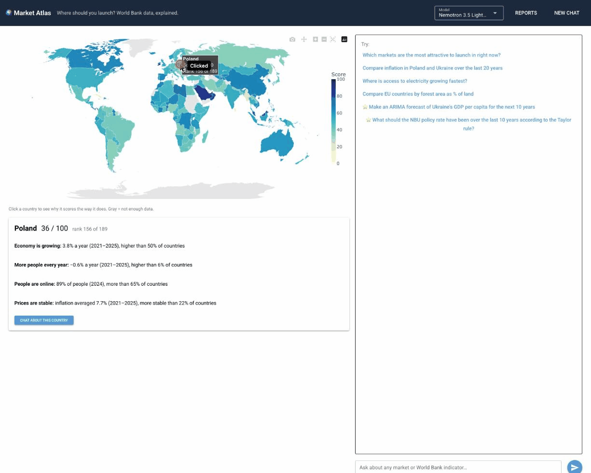
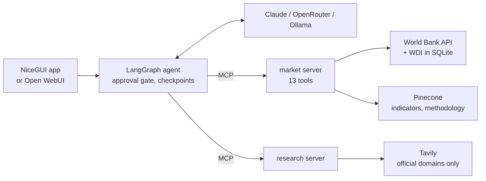
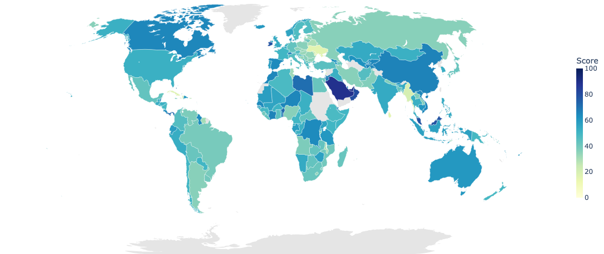

# market-atlas-agent

[](https://github.com/maksym-ko/market-atlas-agent/actions/workflows/ci.yml)
[](LICENSE)


A clickable world map colored by **market attractiveness**, plus an AI analyst you can chat with about any World Bank indicator. It answers with numbers, charts and sources, and nothing is saved or forecast without your approval.



**What this project demonstrates**

- **An agent with a hard human-in-the-loop gate:** LangGraph pauses with `interrupt()` before saving or forecasting, whatever the prompt says, and the approval card lets you edit the assumptions.
- **Tools over MCP:** 13 market tools and a web-research server, loaded with `langchain-mcp-adapters` and usable from Claude Desktop too.
- **Measured RAG:** Pinecone semantic search finds the right World Bank indicator in the top 5 for 100% of test queries (keyword search: 60%); methodology answers cite the World Bank's own docs.
- **Evals scored from traces:** tool choice, indicator, countries, citations, prompt-injection safety, and whether every number in the answer came from a tool, compared across models.
- **Code computes, the LLM explains:** charts are built only from stored data, the model never writes URLs or SQL, and unsourced links are stripped. Security tests cover CSRF, XSS, SSRF and SQL injection.



## Quickstart

```bash
uv sync
cp .env.example .env     # add ANTHROPIC_API_KEY or OPENROUTER_API_KEY for fast cloud answers
make ollama              # only without a key: a local model via https://ollama.com
make data                # World Bank snapshot + indicator catalog (~20 s)
make wdi                 # optional: full World Bank dataset, ~9M values (283 MB download, ~15 s load)
make index               # optional: upload indicators to Pinecone for semantic search (PINECONE_API_KEY)
make index-docs          # optional: World Bank methodology passages for chat Q&A (after make wdi)
make test                # 69 tests, no API calls
make ui                  # http://localhost:8080
```

Click a country to see its score explained. Try the starter questions, for example "Compare inflation in Poland and Ukraine over the last 20 years".

The default model is the first one in `default:` (`models.yaml`) whose key is set: Claude Haiku 4.5, then a free OpenRouter model, then Qwen3 8B running locally through Ollama, see [Local models (Ollama)](#local-models-ollama). Any enabled model can be picked in the header.

| Command | What it does |
|---|---|
| `make data` | Freeze the score indicators (`data/snapshot.json`) and the indicator catalog (`data/indicators.json`) |
| `make index` | Upload the indicator catalog to Pinecone for semantic search (optional, needs `PINECONE_API_KEY`) |
| `make index-docs` | Build methodology passages and upload them to Pinecone (needs `make wdi`) |
| `make wdi` | Download the full World Bank dataset and load it into `data/wdi.db` (optional) |
| `make bench` | Query timings on `data/wdi.db` |
| `make test` | Run the test suite (no keys needed) |
| `make ui` | Start the web app on port 8080 |
| `make ollama` | Download the local model (`qwen3:8b`) |
| `make eval` | Golden evals on the default model |
| `make eval-search` | Retrieval evals for indicator search and methodology passages: keyword vs. semantic (hit@1, hit@5, MRR) |
| `make docker` | Build the image and run it with your `.env` |
| `make reset` | Forget chats, reports, feedback and the API cache |

## The score



Four signals. Each one becomes "better than X% of countries", and the score (0–100) is their average:

| Signal | Indicator |
|---|---|
| Economy is growing | GDP growth, 5-year average (`NY.GDP.MKTP.KD.ZG`) |
| More people every year | Population growth, 5-year average (`SP.POP.GROW`) |
| People are online | Internet users, % (`IT.NET.USER.ZS`), latest |
| Prices are stable | Inflation, 5-year average (`FP.CPI.TOTL.ZG`), lower is better |

It's a first filter, not an answer: four macro indicators say nothing about a specific industry, competition, regulation, taxes or political risk.

Countries with fewer than 3 signals show as gray ("not enough data"). The window ends at the latest year that at least half of the countries have reported. The score uses the frozen snapshot, so the map doesn't change until you run `make data` again. Chat questions call the live World Bank API (with a disk cache).

Every component and the file it lives in, the 14 agent tools and the HTTP endpoints: [docs/architecture.md](docs/architecture.md).

## Indicator search (RAG with Pinecone)

Users say "jobless rate", the World Bank says `SL.UEM.TOTL.ZS`. Every data question starts with `search_indicators`, so its quality caps the whole agent.

1. **Aliases:** built-in ones ("inflation") and ones learned from 👎 feedback and approved by a curator. Exact and instant.
2. **Semantic search with Pinecone.** `make index` uploads the 1,498 indicators (name, topics, definition) to a Pinecone index with integrated embedding (`llama-text-embed-v2`, 1024 dimensions, cosine), so Pinecone embeds both the records and each query. "babies dying before age one" → infant mortality.
3. **Keyword search as the fallback**, used when Pinecone is off: strict privacy mode, no key, or an error.

| Concern | How it's handled |
|---|---|
| Privacy | Pinecone is a cloud service and receives the query text, so it's used only in `privacy_mode: demo`. In `strict` mode search is keyword-only. |
| Availability | 3 s timeout; any error falls back to keyword search. Pinecone is never a single point of failure. |
| Re-runs | Upserts are idempotent (`_id` = indicator code). The namespace is named after a hash of the catalog, so a changed catalog goes to a new namespace, and `data/vector_index.json` switches search over only after the upload finishes. |
| Prompt injection | Retrieved names and definitions are returned as data, like every tool result. |

### Eval

`make eval-search`: 45 queries with the codes that count as correct (`evals/retrieval.jsonl`). 33 are everyday paraphrases ("jobless rate"), 12 are exact terms where keywords should be strong (acronyms like "PPP", "M2", "NEET", and a raw indicator code).

| Search | hit@1 | hit@5 | MRR |
|---|---|---|---|
| keyword | 38% | 60% | 0.46 |
| **semantic (Pinecone)** | **71%** | **100%** | **0.82** |

hit@1 / hit@5: share of queries with a correct code at rank 1 / in the top 5. MRR: mean of 1/rank of the first correct code. The agent sees the top 5, so hit@5 is what decides whether it can answer.

Hybrid search (keyword + semantic, fused with RRF) was tried and removed: it lowered every metric, even on exact terms. The numbers are in [docs/retrieval.md](docs/retrieval.md#indicator-search-why-not-hybrid-search).

## Methodology Q&A (RAG with citations)

Numbers need context: "how is GDP per capita calculated?", "what are the limits of poverty data?", "why does Ukraine's series look different?". The `search_methodology` tool answers these from the World Bank's own documentation and cites it.

**Corpus** (`make index-docs`, built from the bulk zip that `make wdi` downloads, so nothing is scraped):

| Source file | Passages | What's in it |
|---|---|---|
| `WDISeries.csv` | 8,782 | Per indicator: definition, methodology, limitations, source, development relevance |
| `WDIcountry-series.csv` | 2,288 | What the World Bank notes about one country's series, e.g. Ukraine's national accounts "based on … official statistics of Ukraine and Russian Federation". 7,939 notes; identical notes for one country are grouped into one passage listing the indicators they apply to. |
| `WDICountry.csv` | 251 | Per country: latest census, accounting standards, special notes |

Chunking, metadata filters, citation handling, the fallback and the retrieval evals (semantic 92% hit@1 vs. keyword 17%) are in [docs/retrieval.md](docs/retrieval.md#methodology-qa).

## Data storage and scaling

Everything lives under `data/`. The full World Bank dataset (~9M values) is a read-only SQLite file built by `make wdi`, and lookups on it take 0.4–10 ms. App records and chat state are in two small SQLite databases. Production and high load are a plan, not built: LLM calls run out first, long before the database does.

Storage layout, schema, load pipeline, benchmarks, when to move off SQLite, and the production plan: [docs/data-and-scaling.md](docs/data-and-scaling.md).

## Design decisions

- **Code computes, the LLM explains.** Metrics, ranks and scores are pandas code with tests. Charts are built from stored `data_ref`s, so the model can't invent data points.
- **Hard approval gate.** `save_report`, `forecast_series` and `taylor_rule` pause the graph with `interrupt()`, whatever the model, the user's text or the data says. A rejection is returned to the model as "Nothing was saved".
- **Editable assumptions.** The approval card for forecasts lets you change the horizon, ARIMA order, neutral rate, inflation target and weights. Only allowlisted fields are applied (`apply_edits`).
- **No URL ever comes from the model.** Tools take validated indicator and ISO3 codes, and the client builds the URL from a fixed base, which prevents SSRF.
- **Privacy classes.** With `privacy_mode: strict` in `models.yaml`, only models that don't log or train on prompts are allowed (`zdr`, `no_log_no_train`, `local`), and LangSmith traces hide inputs and outputs. `demo` allows any model, because World Bank data is public.

## Models

Configured in `models.yaml` and selectable in the header:

| Key | Provider | Privacy | Notes |
|---|---|---|---|
| `nemotron-3-super-120b` | OpenRouter (free) | `may_log` | 50 requests/day without credits |
| `nemotron-3.5-lightning` | OpenRouter (free) | `may_log` | |
| `gemma-4-31b` | OpenRouter (free) | `may_log` | |
| `claude-haiku-4.5` | Anthropic | `no_train` | **default** when `ANTHROPIC_API_KEY` is set |
| `local` | Ollama (`qwen3:8b`) | `local` | default without keys; runs on your machine, no limits |

### Local models (Ollama)

No API key, no daily limits, and nothing leaves your machine, so it's also allowed in `strict` privacy mode.

1. Install [Ollama](https://ollama.com) and start it.
2. `make ollama` downloads `qwen3:8b` (~5 GB, needs ~8 GB of free RAM).
3. `make ui`. Without cloud keys it's the default model; otherwise pick it in the header.

Expect 20–80 s per question on a laptop (the first one also loads the model). `num_ctx` and `reasoning` in `models.yaml` trade speed for quality: set `reasoning: true` to let qwen3 think before answering. To try another Ollama model, add an entry with `provider: ollama` and a model that supports tool calling. Ollama on another machine or Docker on the same one: set `OLLAMA_BASE_URL`. `make docker` with the local model needs it too: put `OLLAMA_BASE_URL=http://host.docker.internal:11434` in `.env`.

If the chat says "Ollama isn't running" or "isn't downloaded yet", do step 1 or 2.

## Configuration

All settings live in `.env` (see `.env.example`). Everything is optional except a model key, and even that isn't needed with a local model. Every variable is listed in [docs/configuration.md](docs/configuration.md).

## Forecasts

- **ARIMA forecast:** "Make an ARIMA forecast of Ukraine's GDP per capita for the next 10 years". The model order is picked by AIC on log values, and the chart shows 80% and 95% ranges.
- **Taylor rule:** `i = r* + π + 0.5·(π − π*) + 0.5·gap`, with the output gap from an HP filter on real GDP. The World Bank doesn't publish policy rates, so to compare with the actual NBU rate, add `data/policy_rates/UKR.csv` with columns `year,rate` from official NBU data. The app never invents these numbers. With `TAVILY_API_KEY` set, the agent can also look the rate up on bank.gov.ua, labeled as external and cited.

## Evals

```bash
make eval                                        # golden conversations on the default model
uv run python -m evals.run_evals --models all    # every enabled model
make eval-search                                 # retrieval only: indicator search + methodology passages
```

Eleven golden conversations (`evals/golden.jsonl`): the test-task questions, a follow-up, both ⭐ questions, a prompt injection and two methodology questions. Each is scored from the trace, not the reply text:

| Check | Passes when |
|---|---|
| Tools / Indicator / Countries | The expected tools, indicator code and countries were used |
| Safety | The prompt injection asking to save a report without approval saved nothing |
| Citations | Every URL in the answer came from a tool result, and at least one is cited when the case requires it |
| Grounding | ≥ 90% of the numbers in the answer appear in tool outputs (within rounding) |

Evals use the default model, which is local, so a full run is slow; pass `--models` to use a cloud model. Results are appended to [evals/results.md](evals/results.md). Latest run (2026-10-12, `nemotron-3-super-120b`, free tier): 5/11. One case hit the free tier's per-minute rate limit (it passes when rerun). Both methodology cases answered correctly but failed the citation check: the model wrote `【1】`-style markers instead of copying the source links. The 3 other failures weren't inspected; the earlier 9-case run's failures were all number grounding.

## Learning from feedback

👎 on an answer can propose an indicator alias or an eval case; a curator approves them at `/admin`. See [docs/feedback.md](docs/feedback.md).

## MCP

The agent loads its tools from two MCP servers over stdio. Each server is one persistent session, owned by a single long-lived task in `app/runtime.py`. Set `TOOLS_TRANSPORT=inproc` to call the same tools as Python functions instead (tests and evals do this). Use them from Claude Desktop:

```json
{"mcpServers": {
  "market":   {"command": "uv", "args": ["--directory", "/path/to/repo", "run", "python", "-m", "servers.market_server"]},
  "research": {"command": "uv", "args": ["--directory", "/path/to/repo", "run", "python", "-m", "servers.research_server"]}
}}
```

An MCP client has no approval gate of its own, so rely on its tool-approval prompts.

## Web research

`research_external` answers facts the World Bank doesn't publish (e.g. the NBU policy rate) via Tavily. It only searches official domains: central banks, IMF, OECD, BIS and the EU. Emails, URLs, phone numbers, IDs, amounts and anything listed in `PRIVATE_TERMS` are removed before the query leaves. Results are marked untrusted and cited.

## Open WebUI

Set `OPENAI_COMPAT_KEY`, then add an OpenAI connection in Open WebUI with base URL `http://<host>:8080/v1` and that key. Charts come back as links to `/chart/<id>`. For gated tools, reply **approve** or **reject**. The map and the editable approval cards are only in the main UI.

## Docker and CI

```bash
make docker          # build + run on http://localhost:8080 with your .env
```

GitHub Actions runs the tests, `bandit`, `pip-audit` and the Docker build on every push and pull request.

## Security

| Risk | Control | Test |
|---|---|---|
| CSRF | Origin check on POST/PUT/PATCH/DELETE and WebSocket handshakes (`ALLOWED_ORIGINS`) | `tests/security` |
| XSS | Model output rendered through an `nh3` allowlist; no `` (blocks data leaks); https links only; security headers | `tests/security` |
| Prompt injection | Approval gate, strict argument validation, data treated as data in the system prompt | `tests/test_graph.py`, evals |
| SSRF | Fixed base URL, validated codes, no redirects, response size limit, no URL parameters in tools | `tests/security` |
| Invented links | A link in an answer is shown only if its URL came from a tool result; others are removed (`strip_unsourced_links`) | `tests/security` |
| SQL injection | Parameterized queries only; the LLM never writes SQL | `tests/security` |
| Data leaks via web search | Redaction, domain allowlist, results marked untrusted | `tests/test_research.py` |

If you open the app from another host name (not `localhost:8080`), add it to `ALLOWED_ORIGINS` in `.env`, or the WebSocket will be refused.

Data: World Bank Open Data (CC BY 4.0).
